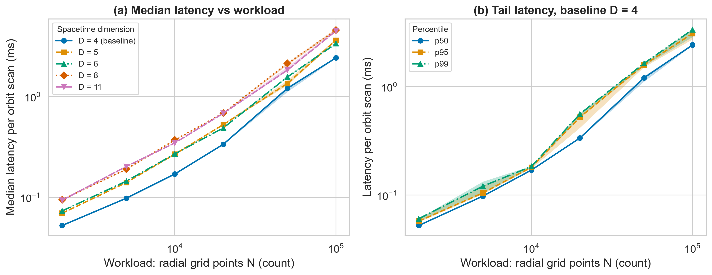
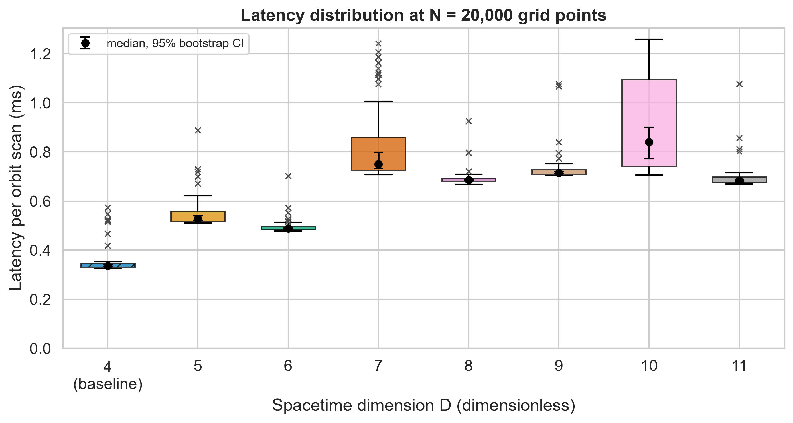
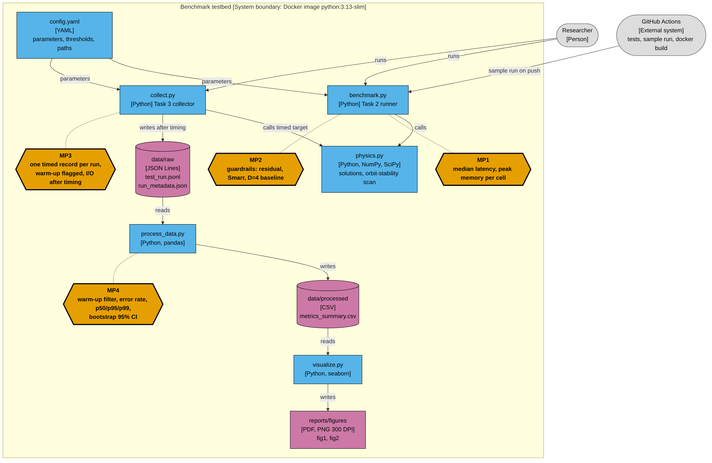

# Spacetime Dimensionality and Black-Hole Properties: A Computational Benchmark

**Authors:** Talgat Bakytuly, Dauletuly Amirlan
**Course:** Research Methods, Task 2-3

## Research Question

How does changing the number of spacetime dimensions *D* affect the geometry and properties of black holes? (RQ3 from Task 1, *Multidimensional Spacetime and the Theory of Relativity*.)

RQ1 and RQ2 are descriptive and covered by the literature review. RQ3 is tested computationally: we evaluate the Schwarzschild-Tangherlini and single-spin Myers-Perry solutions for *D* = 4...11 and compare them with the *D* = 4 baseline (Schwarzschild/Kerr).

- **H0:** for *D* >= 5 the properties do not differ qualitatively from *D* = 4.
- **H1:** for some *D* >= 5 they do (no spin bound, no stable circular orbits).

Units: G = c = hbar = k_B = 1, M = 1.

## Overview

| Item | Value |
|---|---|
| Independent variables | dimension *D*, spin chi = a / mu^(1/(D-3)), solution family |
| Primary metric | B(D): horizon exists at chi = 4 (no spin bound) |
| Secondary metrics | r_ph/r_h, stable circular orbits, T_H, entropy, chi_max |
| Guardrails | root residual <= 1e-10, Smarr error <= 1e-9, D = 4 reproduced, latency <= 1 s |
| Baseline | D = 4 Schwarzschild / Kerr |

## Planned benchmarks

| ID | Benchmark | Family | Sweep |
|---|---|---|---|
| B1 | Horizon radius, area, entropy, temperature | Tangherlini | D = 4...11 |
| B2 | Photon sphere ratio, stable orbits | Tangherlini | D = 4...11 |
| B3 | Spin bound | Myers-Perry | D = 4...11, chi in [0, 4], 41 points |
| B4 | Smarr relation check | Myers-Perry | all cells |
| B5 | Latency and peak memory | both | 30 repeats per cell |

## Results & Discussion

All numbers come from `data/raw/test_run.jsonl` (2,640 timed runs: 48 cells of D x N, 5 warm-up + 50 benchmark runs each; 240 warm-up runs discarded; error rate 0%). Hardware and software of the run are recorded in `data/raw/run_metadata.json`. The full, executed analysis is `notebooks/01_data_analysis.ipynb`.

**What is measured.** The function under test is the circular-orbit stability scan of `src/physics.py`. The workload N is its number of radial grid points; the baseline is D = 4 (Schwarzschild/Kerr). Latency is wall-clock time of one call, with the warm-up phase excluded and file I/O kept outside the timed region.

### Latency at N = 20,000 grid points

| Dimension D | Role | Median (p25-p75), ms | p95, ms | p99, ms | Median / baseline | Error rate |
| --- | --- | --- | --- | --- | --- | --- |
| 4 | **baseline** | 0.336 (0.331-0.345) | 0.524 | 0.560 | 1.00 | 0.0% |
| 5 | compared | 0.528 (0.517-0.559) | 0.710 | 0.810 | 1.57 | 0.0% |
| 6 | compared | 0.489 (0.484-0.496) | 0.540 | 0.638 | 1.45 | 0.0% |
| 7 | compared | 0.750 (0.725-0.860) | 1.175 | 1.224 | 2.23 | 0.0% |
| 8 | compared | 0.685 (0.681-0.694) | 0.761 | 0.862 | 2.04 | 0.0% |
| 9 | compared | 0.714 (0.709-0.729) | 0.819 | 1.071 | 2.12 | 0.0% |
| 10 | compared | 0.841 (0.741-1.095) | 1.224 | 1.243 | 2.50 | 0.0% |
| 11 | compared | 0.683 (0.675-0.700) | 0.806 | 0.968 | 2.03 | 0.0% |

Values are median (p25-p75) over 50 runs. Median / baseline is the latency of the row divided by the latency of D = 4.

### Scientific result (primary metric B(D) and spin bound)

| D | B(D), horizon at chi = 4 | chi_max on grid | r_ph / r_h | Stable circular orbit |
| --- | --- | --- | --- | --- |
| 4 | 0 | 0.5 | 1.500 | yes |
| 5 | 0 | 1.0 | 1.414 | no |
| 6 | 1 | 4.0 | 1.357 | no |
| 7 | 1 | 4.0 | 1.316 | no |
| 8 | 1 | 4.0 | 1.285 | no |
| 9 | 1 | 4.0 | 1.260 | no |
| 10 | 1 | 4.0 | 1.240 | no |
| 11 | 1 | 4.0 | 1.223 | no |

B(4) = B(5) = 0 and B(D) = 1 for D >= 6, so H0 is rejected by the primary metric, and all guardrails pass. chi_max for D = 4 and D = 5 is resolved only to the grid step 0.1. This confirms known analytic results (Emparan and Reall 2008); it is not observational evidence for extra dimensions.

### Figures



**Figure 1.** Latency of one orbit scan against the workload N (radial grid points), log-log axes. (a) Median latency for five spacetime dimensions; D = 4 is the baseline. (b) p50, p95 and p99 of the baseline. Shaded bands are 95% percentile-bootstrap confidence intervals (2,000 resamples, seed 42) of each statistic, from 50 runs per cell. Median latency grows almost linearly with N (log-log slope 0.99). The p99 interval is wide because it rests on the one or two slowest of 50 runs.



**Figure 2.** Latency distribution per spacetime dimension at N = 20,000. Boxes show p25 to p75, whiskers 1.5 x IQR, crosses are flagged outliers (kept in all statistics). The black marker with caps is the median with its 95% bootstrap CI. The hatched box is the baseline D = 4. Vector versions: `reports/figures/*.pdf`.

### Discussion

* Warm-up matters: the first warm-up run of a cell was on median 1.55 times slower than the benchmark median (range 0.92 to 4.1 times), so keeping it would inflate the tail statistics.
* Every dimension above the baseline is slower than D = 4 at N = 20,000 (1.4 to 2.5 times; baseline median 0.336 ms), with the largest medians at D = 7 and D = 10, which are also the noisiest cells. The 95% CIs of the median do not overlap for any of the seven neighbouring pairs. The cause was not investigated, so this is reported as an observation.
* Tails are light (at N = 20,000 the p99 is a median of 1.49 times p50, at most 1.67 times) and 9.5% of runs are flagged as outliers.
* Limitations of the measurement: one machine, one process, a single measured function, 50 runs per cell; background noise on a shared machine cannot be excluded.

## Domain model

Track: Software Engineering. [`docs/domain_model.md`](docs/domain_model.md) holds the C4 container diagram with the metric collection points MP1-MP4, the measurement-isolation rules, the raw-record schema, the LaTeX definitions of the physical and statistical quantities, and the notation table.



## Structure

```
.
├── README.md
├── LICENSE
├── Dockerfile
├── requirements.txt              # Task 2 stack (exact pins)
├── requirements-analysis.txt     # Task 3 stack: pandas, matplotlib, seaborn (exact pins)
├── .gitignore
├── configs/config.yaml
├── data/
│   ├── sample/sample_grid.csv    # micro sample for the smoke test
│   ├── raw/                      # test_run.jsonl (warm-up and benchmark runs), run_metadata.json
│   └── processed/                # metrics_summary.csv, physics_summary.csv
├── docs/
│   ├── methodology_card.md
│   ├── domain_model.md           # C4 diagram, LaTeX definitions, notation
│   └── img/c4_containers.png
├── notebooks/01_data_analysis.ipynb
├── reports/figures/              # fig1_latency_vs_load, fig2_distribution_boxplot (.pdf and .png, 300 DPI)
├── src/
│   ├── physics.py
│   ├── benchmark.py              # Task 2 runner
│   ├── collect.py                # raw .jsonl collector
│   ├── process_data.py           # warm-up filter, statistics, bootstrap CI
│   └── visualize.py              # figures
├── scripts/run.sh
├── tests/                        # physics, collector, statistics
└── results/
```

## System requirements

Docker, or Python 3.13 with `pip install -r requirements.txt` (benchmark and collector). The analysis, figures and notebook additionally need `pip install -r requirements-analysis.txt` (the notebook also needs `jupyterlab`). The benchmark runs in under a second and the collector in a few seconds, under 100 MB RAM.

## Quickstart

```bash
git clone https://github.com/Tako1337/spacetime-dimensions-bh.git && cd spacetime-dimensions-bh
docker build -t dimbh .
docker run --rm -v "$(pwd)/results:/app/results" dimbh
```

Full sweep: add `--full` after `dimbh`. Tests:

```bash
docker run --rm --entrypoint python dimbh -m unittest discover -s tests -t .
```

Without Docker:

```bash
pip install -r requirements.txt && ./scripts/run.sh --sample
```

Output goes to `results/` (`results_<mode>.csv`, `summary_<mode>.json`, `benchmark.log`).

### Task 3: collect, analyse, plot

```bash
pip install -r requirements-analysis.txt
python -m src.collect          # raw log: data/raw/test_run.jsonl + run_metadata.json
python -m src.process_data     # data/processed/*.csv
python -m src.visualize        # reports/figures/*.pdf and *.png
```

The collector also runs in the Docker image (`docker run --rm -v "$(pwd)/data/raw:/app/data/raw" --entrypoint python dimbh -m src.collect`); the image does not contain pandas, so analysis runs outside it. To open the notebook: `pip install jupyterlab`, then `jupyter lab notebooks/01_data_analysis.ipynb` and choose *Restart & Run All*. Re-running the collector on your own machine replaces the raw log; the committed log carries its hardware in `run_metadata.json`.


## Limitations

The benchmark checks known analytic results and gives no observational evidence for extra dimensions. Stability of ultraspinning horizons (D >= 6) is not tested. Latency results are from a single machine and a single measured function.

## License / Citation

MIT License. Cite as: Bakytuly, T., Dauletuly, A. (2026). *Spacetime Dimensionality and Black-Hole Properties: A Computational Benchmark*. GitHub.

References: Tangherlini (1963); Myers and Perry (1986); Emparan and Reall (2008); Emparan (2025).
