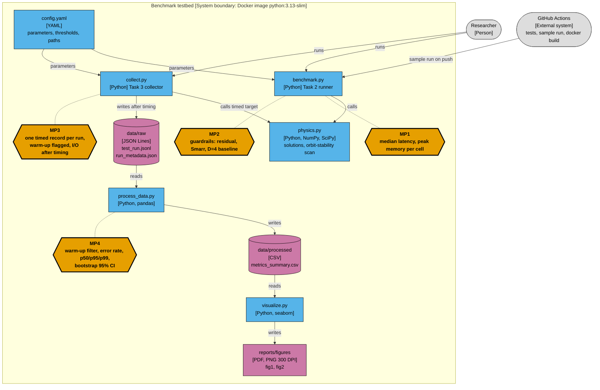
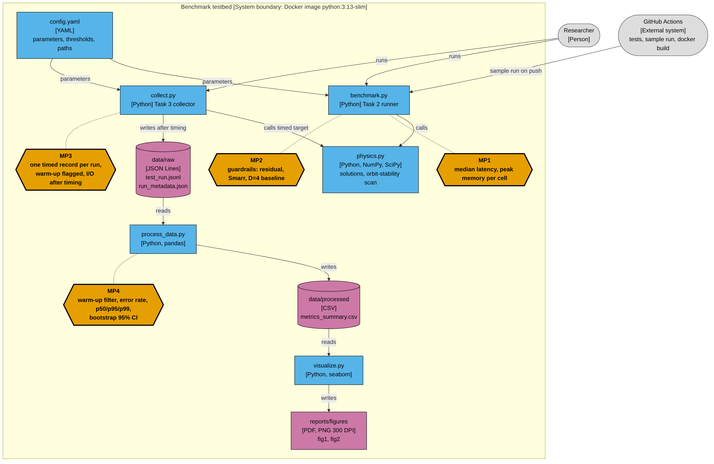

# Domain model

Formal description of the benchmark testbed for *Spacetime Dimensionality and Black-Hole Properties*. Track: **Software Engineering** (C4 container model with the metric collection points marked). Because the system computes analytic physics, the same file also fixes the mathematics of the measured quantities and of every statistic reported in the README (LaTeX, with a notation table).

## 1. C4 container diagram (level 2)

Orange hexagons **MP1-MP4** are the points where a metric is collected. Blue = executable container, pink = data store, grey = outside the system boundary.

PNG copy for viewers without Mermaid support: 

### Metric collection points

| ID | Container | What is collected | Where in code | Used for |
| --- | --- | --- | --- | --- |
| MP1 | `benchmark.py` | median latency (30 repeats, 3 warm-up) and peak memory per cell | `measure_cell` | Task 2 secondary metrics |
| MP2 | `benchmark.py` | root residual, Smarr error, D = 4 reproduction, max latency | `summarize` | guardrails, exit code |
| MP3 | `collect.py` | one record per run with a nanosecond-resolution latency, `phase`, `ok`, `error` | `run_cell` | raw data of Task 3 |
| MP4 | `process_data.py` | warm-up filtered statistics, error rate, p50/p95/p99, bootstrap CIs, outlier flags | `aggregate` | `metrics_summary.csv`, figures, README |

### Measurement isolation rules

1. Only the target call lies between the two `perf_counter_ns()` reads (`collect.target`).
2. Records are kept in memory and written to disk after all timing is finished, so I/O never enters a latency.
3. Each cell has a logged warm-up phase (`phase = "warmup"`), excluded from every statistic.
4. The garbage collector is disabled while a cell is timed and re-enabled afterwards.
5. Cell order is shuffled with a fixed seed so slow drift of the machine is spread over all cells.
6. A failed run is logged with `ok = false` and counted in the error rate; it is never dropped silently.

### Raw record schema (`data/raw/test_run.jsonl`)

| Field | Type | Meaning |
| --- | --- | --- |
| `run_id` | int | global order of execution |
| `ts_us` | int | wall-clock time, microseconds since epoch, taken after the timed call |
| `phase` | str | `warmup` or `benchmark` |
| `family` | str | measured function, here `orbit_scan` |
| `D` | int | spacetime dimension |
| `n_grid` | int | workload N: radial grid points of the orbit-stability scan |
| `rep` | int | repetition index inside the phase |
| `latency_ms` | float | latency of the target call, ms |
| `ok`, `error` | bool, str or null | success flag and exception text |

Environment metadata (CPU model, core count, RAM, OS, Python, NumPy, SciPy, git commit, SHA-256 of `config.yaml`) is written to `data/raw/run_metadata.json`.

## 2. Physics: quantities that are computed

Units G = c = hbar = k_B = 1, mass M = 1.

Area of the unit sphere and the mass parameter:

$$\Omega_{D-2} = \frac{2\pi^{(D-1)/2}}{\Gamma\left(\frac{D-1}{2}\right)}, \qquad \mu = \frac{16\pi M}{(D-2)\,\Omega_{D-2}}$$

Dimensionless spin for single-spin Myers-Perry:

$$\chi = \frac{a}{\mu^{1/(D-3)}}$$

The horizon radius $r_h$ is the largest root of

$$g(r) = r^{D-5}\left(r^{2} + a^{2}\right) - \mu = 0$$

Primary metric of the hypothesis test (a horizon exists at the cap $\chi_{\mathrm{cap}} = 4$):

$$B(D) = \begin{cases} 1 & \text{if } g(r) = 0 \text{ has a root at } \chi = \chi_{\mathrm{cap}} \\ 0 & \text{otherwise} \end{cases}$$

$H_0$ is rejected if $B(4) = 0$ and $B(D) = 1$ for at least one $D \ge 5$, and all guardrails pass.

Guardrail identity (Smarr relation) with entropy $S = A/4$:

$$(D-3)\,M = (D-2)\left(T_H S + \Omega_H J\right)$$

Photon-sphere ratio of the non-rotating solution, $n = D - 3$:

$$\frac{r_{ph}}{r_h} = \left(\frac{n+2}{2}\right)^{1/n}$$

## 3. Statistics: how the measured latencies are summarised

For one cell $(D, N)$ let $L_1, \dots, L_n$ be the latencies of the successful benchmark runs, $n_{\mathrm{ok}} \le n$.

Error rate (guardrail metric, counted over all benchmark runs):

$$\varepsilon = 1 - \frac{n_{\mathrm{ok}}}{n}$$

Percentile (linear interpolation of the order statistics):

$$p_q = \hat{F}^{-1}(q/100), \qquad q \in \{25, 50, 75, 95, 99\}$$

Outlier flag (Tukey fences, flagged and kept):

$$L_i \notin \left[\,p_{25} - 1.5\,(p_{75}-p_{25}),\; p_{75} + 1.5\,(p_{75}-p_{25})\,\right]$$

Percentile bootstrap confidence interval of a statistic $\theta$ (median, $p_{95}$, $p_{99}$), with $B = 2000$ resamples of size $n_{\mathrm{ok}}$ drawn with replacement and $\alpha = 0.05$:

$$\mathrm{CI}_{95\%}(\theta) = \left[\,Q_{\alpha/2}\big(\hat\theta^{*}_1,\dots,\hat\theta^{*}_B\big),\; Q_{1-\alpha/2}\big(\hat\theta^{*}_1,\dots,\hat\theta^{*}_B\big)\,\right]$$

The random generator is seeded (`numpy` seed 42), so the intervals are reproducible.

## 4. Notation

| Symbol | Type | Meaning | Unit |
| --- | --- | --- | --- |
| $D$ | integer in $\{4,\dots,11\}$ | spacetime dimension; $D = 4$ is the baseline | 1 |
| $n = D - 3$ | integer | exponent in the Tangherlini solution | 1 |
| $M$ | scalar | black-hole mass, fixed to 1 | natural |
| $\mu$ | scalar | mass parameter | natural |
| $a$, $\chi$ | scalars | rotation parameter, dimensionless spin | natural, 1 |
| $\chi_{\mathrm{cap}}$ | scalar | upper end of the spin grid, 4 | 1 |
| $r_h$, $r_{ph}$ | scalars | horizon and photon-sphere radius | natural |
| $T_H$, $S$, $A$ | scalars | Hawking temperature, entropy, horizon area | natural |
| $\Omega_H$, $J$ | scalars | horizon angular velocity, angular momentum | natural |
| $B(D)$ | binary | primary metric, horizon at $\chi_{\mathrm{cap}}$ | 1 |
| $N$ | integer | workload: radial grid points of the orbit scan | count |
| $\mathcal{C} = \{(D, N)\}$ | set | measured cells, 8 x 6 = 48 | |
| $L_i$ | scalar | latency of run $i$ | ms |
| $n$, $n_{\mathrm{ok}}$ | integers | benchmark runs and successful runs per cell | count |
| $\varepsilon$ | scalar | error rate | 1 |
| $p_q$ | scalar | $q$-th percentile of latency | ms |
| $B$, $\hat\theta^{*}$ | integer, scalar | number of bootstrap resamples, statistic of a resample | count, ms |
| $\alpha$ | scalar | significance level, 0.05 | 1 |
